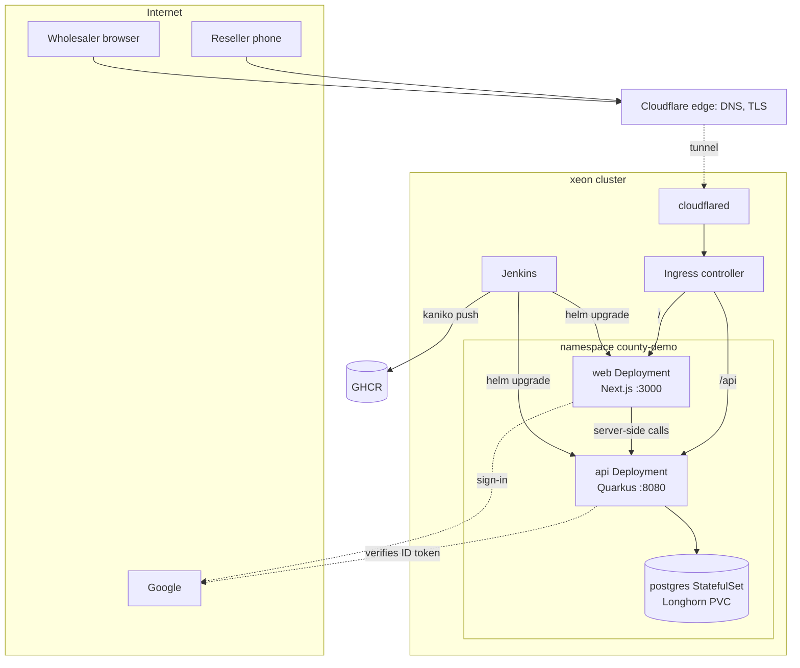

# county v1: Kubernetes deployment

Date: 2026-10-31
Status: proposed; expands section 8 of the
[v1 design](https://github.com/jasoncalalang/county-architecture/blob/main/design/2026-10-16-v1-design.md)

## 1. Purpose

v1 runs on the xeon cluster. This document fixes how the two deployables and
the database run there, how a commit becomes a running release, and what an
operator does on the first install, on a bad release and on a lost disk.

Goals, in order:

1. One `helm upgrade --install` brings up a working demo.
2. A push to `main` ships without anyone touching the cluster.
3. A bad release rolls itself back.
4. Nothing secret is in git.

Not goals for v1: high availability, autoscaling, a second environment. The
chart is written so that a second environment is a namespace and a values
file, not new templates.

## 2. Cluster assumptions

Confirm before the first install. Each has a value in the chart so that a
wrong assumption is a configuration change, not a redesign.

| # | Assumption | If false |
|---|---|---|
| A1 | xeon is a single-node cluster on containerd with no Docker daemon. | Nothing in this design depends on node count except Longhorn's replica setting. |
| A2 | Longhorn is installed with a storage class named `longhorn` whose replica count fits the node count. | Set `postgres.storageClass`. |
| A3 | The Cloudflare tunnel (`cloudflared`) already runs in the cluster and forwards public hostnames to an ingress controller. | Set `ingress.enabled=false` and point the tunnel's ingress rules at the `county-web` and `county-api` Services directly, matched by path as in section 5. |
| A4 | Jenkins runs in the cluster with the Kubernetes plugin, so a build runs in a pod whose containers the `Jenkinsfile` declares. | A static agent needs Java 21, Node, Kaniko and Helm installed; the stages do not change. |
| A5 | GHCR packages for county are public, as the code is AGPL. | Create a pull secret and set `imagePullSecrets`. |
| A6 | The cluster has no Prometheus. | Set `metrics.serviceMonitor.enabled=true`. |

## 3. Topology



- One namespace per environment. v1 has one, `county-demo`.
- Everything the chart creates carries `app.kubernetes.io/name=county`,
  `app.kubernetes.io/instance=<release>` and
  `app.kubernetes.io/component=api|web|postgres`.
- TLS terminates at the Cloudflare edge. Traffic inside the cluster is plain
  HTTP. There is no cert-manager and no TLS section on the Ingress.

## 4. Workloads

| | api | web | postgres |
|---|---|---|---|
| Kind | Deployment | Deployment | StatefulSet |
| Image | `ghcr.io/jasoncalalang/county-api:<sha>` | `ghcr.io/jasoncalalang/county-web:<sha>` | `postgres:17` |
| Replicas (demo) | 1 | 1 | 1 |
| Port | 8080 | 3000 | 5432 |
| Service | ClusterIP `county-api` | ClusterIP `county-web` | headless `county-postgres` |
| Startup probe | `GET /q/health/started`, up to 60 s | `GET /healthz`, up to 30 s | `pg_isready`, up to 60 s |
| Liveness | `GET /q/health/live` | `GET /healthz` | `pg_isready` |
| Readiness | `GET /q/health/ready` (includes the datasource check) | `GET /healthz` | `pg_isready` |
| Requests | 250m CPU, 384Mi | 100m CPU, 128Mi | 100m CPU, 256Mi |
| Limits | 768Mi, no CPU limit | 256Mi, no CPU limit | 512Mi, no CPU limit |
| Writable paths | emptyDir at `/tmp` | emptyDir at `/app/.next/cache` | PVC at `/var/lib/postgresql/data` |
| Rollout | RollingUpdate, maxSurge 1, maxUnavailable 0 | same | RollingUpdate (brief outage on a Postgres restart, accepted) |

Details:

- **api** runs in JVM mode on the Quarkus `Dockerfile.jvm` base
  (`ubi9/openjdk-21-runtime`), which sizes the heap from the container memory
  limit. Native compilation is deferred (ADR 0007). Flyway runs at start
  (ADR 0009), so the startup probe window is also the migration budget.
- **web** is Next.js with `output: "standalone"`, started with
  `node server.js`. The image carries no environment-specific value: the
  browser calls the API at the relative path `/api`. One image serves every
  environment.
- **web readiness does not depend on api.** A broken api shows as an error on
  the page rather than taking the whole site down.
- **postgres** uses the official image, database `county`, role `county`,
  password from a Secret. Single replica, no streaming replication (ADR 0008).
- **Pods run in UTC.** All date arithmetic uses the tenant's timezone
  explicitly, per the v1 rules; `timestamptz` everywhere.
- **Pod security** for api and web: `runAsNonRoot`, `readOnlyRootFilesystem`,
  `allowPrivilegeEscalation: false`, all capabilities dropped,
  `seccompProfile: RuntimeDefault`. postgres runs as its image's uid 999 with
  `fsGroup: 999` so Longhorn volumes are writable.

Total demo footprint at requests: about 0.5 CPU and 0.8 GiB, which fits any
node xeon is likely to be.

## 5. Networking

One public hostname. This document writes it as `county.example.ph`; the
real one is whatever the tunnel already serves and is set in
`deploy/values/demo.yaml`.

Ingress rules (ADR 0010):

| Path (Prefix) | Backend | Serves |
|---|---|---|
| `/api` | `county-api:8080` | the REST API, with Quarkus `quarkus.http.root-path=/api` |
| `/` | `county-web:3000` | dashboard, reseller page `/order/{token}`, Auth.js under `/auth` |

- **Auth.js is mounted at `/auth`** (`basePath`), not its default `/api/auth`,
  so nothing of web lives under `/api`. The Google OAuth client's redirect URI
  is `https://county.example.ph/auth/callback/google`.
- **Quarkus non-application endpoints** (`/q/health/*`, `/q/metrics`,
  `/q/openapi`) use the absolute path `/q`, outside `/api`, so the Ingress
  never routes them. Probes and scrapers hit the pod directly.
- **Two base URLs, one path.** The browser uses the relative URL `/api`. The
  web server (reseller page rendering, dashboard server components) uses
  `http://county-api:8080/api`. Same path, no CORS, one hostname in the Google
  console.
- **Behind a proxy.** Quarkus sets
  `quarkus.http.proxy.proxy-address-forwarding=true`; Auth.js gets
  `AUTH_TRUST_HOST=true` and `AUTH_URL`, so both build `https://` URLs.
- **NetworkPolicy**, on by default and harmless where the CNI does not
  enforce it: postgres accepts 5432 only from api; api accepts 8080 from web
  and from the ingress controller's namespace; web accepts 3000 from the
  ingress controller's namespace. api and web may egress to the internet
  (Google) and to cluster DNS.
- **Cloudflare rate limit** on `/api/order/*`, for example 60 requests per
  minute per IP, is recommended as defence in depth against token probing
  (ADR 0003 already makes probing blind with 404s). Not required for the demo.

## 6. Configuration and secrets

Non-secret configuration is rendered into ConfigMaps from values. Secrets are
created once per environment by the operator, named in values and referenced
by `secretKeyRef`; the chart never renders a Secret (ADR 0011). All keys are
UPPER_SNAKE.

api:

| Variable | Source | Value |
|---|---|---|
| `QUARKUS_HTTP_ROOT_PATH` | ConfigMap | `/api` |
| `QUARKUS_HTTP_NON_APPLICATION_ROOT_PATH` | ConfigMap | `/q` |
| `QUARKUS_DATASOURCE_JDBC_URL` | ConfigMap | `jdbc:postgresql://county-postgres:5432/county` |
| `QUARKUS_DATASOURCE_USERNAME` | ConfigMap | `county` |
| `QUARKUS_DATASOURCE_PASSWORD` | Secret `county-postgres`, key `POSTGRES_PASSWORD` | |
| `QUARKUS_OIDC_APPLICATION_TYPE` | ConfigMap | `service` (bearer verification only; `quarkus.oidc.provider=google` is in `application.properties`) |
| `QUARKUS_OIDC_CLIENT_ID` | Secret `county-google`, key `GOOGLE_CLIENT_ID` | expected audience of the ID token |
| `COUNTY_PUBLIC_URL` | ConfigMap | `https://county.example.ph`, used to build order links |
| `QUARKUS_LOG_CONSOLE_JSON` | ConfigMap | `true` |
| `TZ` | ConfigMap | `UTC` |

web:

| Variable | Source | Value |
|---|---|---|
| `AUTH_URL` | ConfigMap | `https://county.example.ph/auth` |
| `AUTH_TRUST_HOST` | ConfigMap | `true` |
| `AUTH_SECRET` | Secret `county-web`, key `AUTH_SECRET` | |
| `AUTH_GOOGLE_ID` | Secret `county-google`, key `GOOGLE_CLIENT_ID` | |
| `AUTH_GOOGLE_SECRET` | Secret `county-google`, key `GOOGLE_CLIENT_SECRET` | |
| `API_INTERNAL_URL` | ConfigMap | `http://county-api:8080/api` |
| `PORT` | ConfigMap | `3000` |

postgres: `POSTGRES_DB=county`, `POSTGRES_USER=county`, `POSTGRES_PASSWORD`
from Secret `county-postgres`, `PGDATA=/var/lib/postgresql/data/pgdata`.

Secrets per environment:

| Secret | Keys | Origin |
|---|---|---|
| `county-google` | `GOOGLE_CLIENT_ID`, `GOOGLE_CLIENT_SECRET` | the Google Cloud OAuth client for this environment |
| `county-postgres` | `POSTGRES_PASSWORD` | `openssl rand -base64 32` |
| `county-web` | `AUTH_SECRET` | `openssl rand -base64 32` |

A missing Secret leaves the pod in `CreateContainerConfigError`; with
`--atomic` the release rolls back and the error names the Secret.

ConfigMaps carry a checksum annotation on the pod template, so a changed
value rolls the pods. Secrets are created outside the chart, so rotating one
needs an explicit `kubectl rollout restart` (section 10).

## 7. Database

- **Storage.** One PVC from the StatefulSet's `volumeClaimTemplates`, 10Gi,
  class `longhorn`. Growing it is a PVC expansion; no data moves.
- **Migrations** (ADR 0009). Flyway runs when api starts. The rollout keeps
  the old pod serving until the new one is ready, so a failing migration
  stalls the rollout, `--atomic` rolls the Deployment back, and the schema
  stays wherever Flyway stopped. Three rules make that safe:
  1. Migrations are forward-only. No undo scripts.
  2. Every migration leaves the schema usable by the previous release:
     expand first (nullable columns, defaults, new tables), switch code,
     contract in a later release.
  3. A migration finishes inside the startup probe window (60 s). Anything
     bigger becomes a Job, and that is the trigger to revisit ADR 0009.
- **Backups.** A Longhorn recurring snapshot of the postgres volume, daily at
  02:00 Asia/Manila, retain 7, attached by labelling the PVC with the
  recurring-job group. Snapshots are crash-consistent; Postgres recovers from
  one as from a power cut. A logical `pg_dump` CronJob to off-cluster storage
  is deferred to the pilot.
- **Restore.** Scale api to 0, revert the Longhorn volume to the chosen
  snapshot (the volume must be detached), scale api back. The exact commands
  go in `deploy/README.md` during implementation. Rehearse once before the
  first demo.
- **Major upgrades** of Postgres are manual dump and restore, outside the
  chart. Minor versions follow the image tag in values.

## 8. Build and release pipeline

Jenkins, `Jenkinsfile` at the repository root, one pipeline for every
branch. Only `main` deploys.

Agent pod containers: `jdk` (Temurin 21), `node` (current LTS), `postgres`
(the sidecar the tests use, reached at `localhost:5432`), `kaniko` (a
maintained fork's executor image, pinned), `helm`.

| Stage | What happens | Fails when |
|---|---|---|
| Checkout | `GIT_COMMIT` becomes the release id for everything downstream. | |
| api | `./gradlew build` with `COUNTY_TEST_JDBC_URL=jdbc:postgresql://localhost:5432/county_test` (ADR 0005). The build also writes the OpenAPI document. | A test fails, or `api/openapi.yaml` in git differs from what the build produced. Contract changes are committed and reviewed, never implicit. |
| web | `npm ci`, generate the API client from `api/openapi.yaml`, `npm test`, `npm run build`. | Vitest fails or `tsc` fails, which is how a changed endpoint is caught. |
| images | Two Kaniko runs in parallel, context at the repository root, `api/Dockerfile` and `web/Dockerfile`, pushed as `ghcr.io/jasoncalalang/county-api:$GIT_COMMIT` and `county-web:$GIT_COMMIT`, layer cache in `<image>-cache`. Every branch builds images so a branch can be deployed by hand to a scratch namespace. | A build fails. |
| chart | `helm lint` and `helm template` with `deploy/values/demo.yaml`. | A template does not render. |
| deploy (`main` only) | `helm upgrade --install county deploy/county -n county-demo -f deploy/values/demo.yaml --set image.tag=$GIT_COMMIT --atomic --wait --timeout 5m` | Any pod fails to become ready in 5 minutes; Helm restores the previous release (ADR 0006). |
| smoke | In-cluster `GET county-api:8080/q/health/ready` and `GET county-web:3000/healthz`; public `GET https://county.example.ph/` is 200. | Any is not 200; the deploy is already live, so this pages the operator by failing the build. |

- **Tags** are the full 40-character commit SHA and nothing else. No
  `latest`, no re-pushed tag (ADR 0007).
- **The Playwright demo loop** is run by hand before a demo in v1. Adding it
  after the smoke stage is deferred until the loop is stable.
- **Credentials Jenkins holds.** A GHCR push token mounted into the Kaniko
  container as `/kaniko/.docker/config.json`. A ServiceAccount
  `jenkins-deployer` bound to a Role in `county-demo` only, covering
  deployments, statefulsets, services, configmaps, secrets (Helm stores
  release state as Secrets), ingresses, networkpolicies, serviceaccounts and
  pods. No cluster-wide rights.
- **Release identity.** The running release is the SHA in the image tag and
  the entry in `helm history`. `Chart.yaml` `version` is bumped only when
  templates change; `appVersion` is not used.

## 9. Helm chart

```
deploy/
  county/
    Chart.yaml
    values.yaml                 defaults; image.tag deliberately unset
    templates/
      _helpers.tpl
      api/        deployment.yaml service.yaml configmap.yaml networkpolicy.yaml
      web/        deployment.yaml service.yaml configmap.yaml networkpolicy.yaml
      postgres/   statefulset.yaml service.yaml networkpolicy.yaml
      ingress.yaml
      servicemonitor.yaml       off by default
  values/
    demo.yaml                   hostname, image tag is still set by the pipeline
  README.md                     first install, restore, rotation commands
```

Values that matter:

| Value | Default | Note |
|---|---|---|
| `image.registry` | `ghcr.io/jasoncalalang` | |
| `image.tag` | unset | `required`; the pipeline sets it |
| `publicUrl` | unset | `required`; `https://county.example.ph` |
| `ingress.enabled`, `ingress.className` | `true`, `nginx` | A3 |
| `api.replicas`, `api.resources` | 1, section 4 | |
| `web.replicas`, `web.resources` | 1, section 4 | |
| `postgres.enabled` | `true` | `false` plus `postgres.externalHost` points api at a database outside the chart |
| `postgres.storageClass`, `postgres.size` | `longhorn`, `10Gi` | A2 |
| `secrets.google`, `secrets.postgres`, `secrets.web` | `county-google`, `county-postgres`, `county-web` | names of existing Secrets |
| `networkPolicy.enabled`, `networkPolicy.ingressNamespace` | `true`, `ingress-nginx` | |
| `metrics.serviceMonitor.enabled` | `false` | A6 |

The chart is applied from the working tree of the built commit. There is no
chart repository and no chart publishing.

## 10. Operations

First install of an environment:

```bash
kubectl create namespace county-demo
kubectl -n county-demo create secret generic county-google \
  --from-literal=GOOGLE_CLIENT_ID=... --from-literal=GOOGLE_CLIENT_SECRET=...
kubectl -n county-demo create secret generic county-postgres \
  --from-literal=POSTGRES_PASSWORD="$(openssl rand -base64 32)"
kubectl -n county-demo create secret generic county-web \
  --from-literal=AUTH_SECRET="$(openssl rand -base64 32)"
helm upgrade --install county deploy/county -n county-demo \
  -f deploy/values/demo.yaml --set image.tag=<sha> --atomic --wait
```

Then, outside the cluster: the tunnel route and DNS record for the hostname,
and the redirect URI on the Google OAuth client.

| Task | Action |
|---|---|
| Release | Merge to `main`. Nothing else. |
| Roll back | `helm rollback county -n county-demo`. The previous image runs on the current schema, which rule 2 in section 7 makes safe. |
| Lost or corrupt disk | Section 7, restore. |
| Rotate a secret | Recreate it with `kubectl create secret ... --dry-run=client -o yaml \| kubectl apply -f -`, then `kubectl -n county-demo rollout restart deployment/county-api deployment/county-web`. |
| Read logs | `kubectl -n county-demo logs deploy/county-api -f`; api logs are JSON lines. |
| Second environment | New namespace, three Secrets, `deploy/values/<env>.yaml`, its own Google OAuth client, a deploy stage in the `Jenkinsfile`. |

## 11. Security

- Non-root, read-only root filesystem, no capabilities, default seccomp for
  api and web.
- NetworkPolicy as in section 5. Postgres is reachable from api only.
- No secret in git, values, Jenkins logs or Helm release history.
- Jenkins can touch one namespace.
- Image tags are treated as immutable; the pipeline never re-pushes one.
- The reseller token endpoints are public by design (ADR 0003). Cloudflare
  rate limiting is the only extra layer in v1.
- `/q/*` (health, metrics, OpenAPI) is not routed by the Ingress.

## 12. Observability

- **Logs.** api writes JSON lines to stdout with the access log on; web writes
  plain lines. `kubectl logs` is the log viewer in v1.
- **Metrics.** api exposes Prometheus metrics at `/q/metrics` through
  Micrometer. They are scraped only if a Prometheus exists (A6).
- **No tracing, no alerts** in v1. The demo operator watches
  `kubectl get pods`.

## 13. Deferred

| Item | When |
|---|---|
| GitOps (Argo CD or Flux) instead of Jenkins applying Helm | a second environment or a second deployer |
| Sealed Secrets or External Secrets | more than one person rotates secrets |
| CloudNativePG or managed Postgres: replication, PITR, off-cluster backups | first pilot customer |
| Logical `pg_dump` CronJob off-cluster | first pilot customer |
| Flyway as a separate Job | a migration that needs more than the startup window |
| Native image for api | node memory becomes the constraint |
| Playwright demo loop in the pipeline | once the loop is stable |
| More than one replica, PodDisruptionBudget, HPA | first pilot customer |

## 14. Decisions recorded

- [ADR 0006](https://github.com/jasoncalalang/county-architecture/blob/main/adr/0006-jenkins-deploys-with-helm.md): Jenkins deploys with Helm on every push to `main`.
- [ADR 0007](https://github.com/jasoncalalang/county-architecture/blob/main/adr/0007-kaniko-images-tagged-by-commit.md): images are built by Kaniko from Dockerfiles and tagged by commit SHA.
- [ADR 0008](https://github.com/jasoncalalang/county-architecture/blob/main/adr/0008-postgres-statefulset-on-longhorn.md): Postgres runs in-cluster as one StatefulSet on Longhorn.
- [ADR 0009](https://github.com/jasoncalalang/county-architecture/blob/main/adr/0009-flyway-migrates-at-api-start.md): Flyway migrates at API start; migrations stay compatible with the previous release.
- [ADR 0010](https://github.com/jasoncalalang/county-architecture/blob/main/adr/0010-one-hostname-api-under-api-path.md): one public hostname, the API under `/api`, Auth.js under `/auth`.
- [ADR 0011](https://github.com/jasoncalalang/county-architecture/blob/main/adr/0011-secrets-created-outside-the-chart.md): Secrets are created outside the chart and referenced by name.
